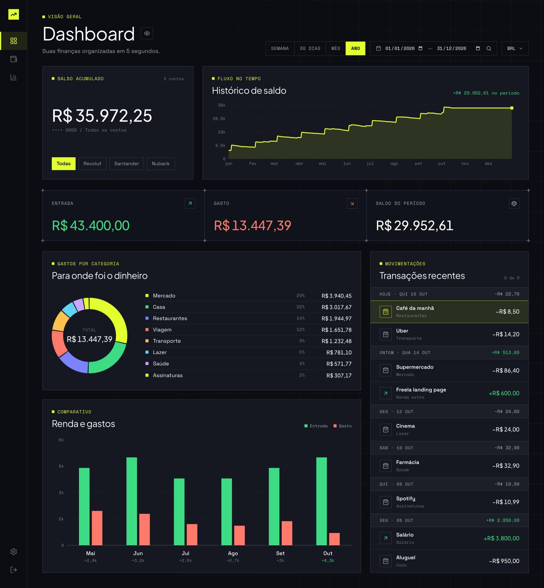

# Money Flow

Personal finance tracker with two interfaces: a Telegram Bot for quick daily expense/income logging (text commands or voice messages) and a React Dashboard for visualization and analytics.

Built as a real tool I use daily to manage finances across currencies (EUR/BRL), now multi-user: anyone can register on the dashboard and link their own Telegram chat.



## Architecture

```
                    ┌──────────────────────┐
                    │     Traefik          │
                    │  (reverse proxy)     │
                    │  TLS + WAF + Rate    │
                    └─────┬──────┬─────────┘
                          │      │
              /api/*      │      │     /*
                          │      │
                 ┌────────▼──┐ ┌─▼──────────┐
                 │  Spring   │ │   React    │
                 │  Boot API │ │  Dashboard │
                 │  (8080)   │ │  (nginx)   │
                 └──┬─────┬──┘ └────────────┘
                    │     │
          ┌─────────▼─┐ ┌─▼──────────────┐
          │ PostgreSQL│ │ OpenAI         │
          │ 17+Flyway │ │ Whisper + GPT  │
          └───────────┘ └────────────────┘

       ┌────────────┐
       │  Telegram  │──webhook──▶ POST /api/integration/telegram-webhook
       │  Bot API   │            (X-Telegram-Bot-Api-Secret-Token)
       └────────────┘
```

## Tech Stack

### Backend
- Java 25 + Spring Boot 4
- Spring Security with JWT (stateless sessions), every read and write scoped by the authenticated owner
- Spring Data JPA (Hibernate) with `ddl-auto=validate`, schema managed by Flyway migrations
- PostgreSQL 17 with custom ENUMs (`frequency`, `operation`, `category_type`, `currency`) and `NUMERIC` for monetary values
- OpenAI Java SDK: Whisper for voice transcription, GPT for parsing the transcription into a transaction
- `telegrambots-meta` for the Telegram webhook payloads

### Frontend
- React 19 + TypeScript + Vite
- Tailwind CSS 4 with the "Tinta" palette (dark, lime accent) and Space Grotesk / Plus Jakarta Sans / Space Mono
- Recharts for balance history, income vs expense and category donut
- lucide-react icons

### Infrastructure
- Docker with multi-stage builds for both backend (Temurin JDK/JRE) and frontend (Node + nginx)
- Docker Compose orchestrating backend, frontend and PostgreSQL (internal network, DB not exposed)
- Traefik v3 as reverse proxy with automatic Let's Encrypt TLS, Coraza WAF (OWASP CRS), rate limiting and security headers
- Self-hosted on VPS

## Database Schema

5 tables with PostgreSQL ENUMs for fixed domains and foreign keys for user-created entities:

| Table | Purpose |
|-------|---------|
| `owner` | User accounts with email/password auth, Telegram chat link and one-time invite (`invite_uuid` + expiration), bot `language` and onboarding state (`onboarding_step`, `onboarding_draft`) |
| `account` | Financial accounts (checking, savings, etc.) with running balance and currency (`BRL`/`EUR`/`USD`) |
| `category` | Transaction categories, per user, typed `EXPENSE`/`INCOME`, unique per `(owner_id, description)` |
| `recurring_payment` | Templates for recurring charges, amount can change over time |
| `transactions` | Immutable financial event records |

Key design decisions:
- `NUMERIC` for all monetary values, `BigDecimal` in Java. Never floating point for money
- Currency lives on the account. There are no exchange rates: amounts in different currencies are never summed together
- `recurring_payment` and `transactions` both have `amount`. Not duplication. The template can change (e.g. gym price increases), the recorded event doesn't
- `recurring_payment_id` in transactions is nullable. Ad-hoc transactions from Telegram don't come from recurring rules
- Schema is version-controlled in `backend/src/main/resources/db/migration` (Flyway) and validated by Hibernate at startup. Existing databases adopt `V1__baseline.sql` through `baseline-on-migrate`

| Migration | Change |
|-----------|--------|
| `V1__baseline.sql` | Original schema (owner, account, category, recurring_payment, transactions) |
| `V2__category_per_owner.sql` | `category.owner_id` + `category.type`, merges duplicated descriptions |
| `V3__account_currency.sql` | `currency` enum and `account.currency` (default `EUR`) |

## Telegram Bot

### Linking a chat
1. Register on the dashboard and open **Configurações → Telegram**
2. Generate an invite: the API returns a deep link `t.me/<bot>?start=<uuid>` valid for 15 minutes
3. Opening the link sends `/start <uuid>` and links that chat to the account. Unlinked chats are refused

### Guided onboarding
Right after the first link the bot walks a new user through setup (state in `owner.onboarding_step`):

1. **Language**: 🇧🇷 Português / 🇬🇧 English buttons (Telegram's language first). Seeds the base categories in that language: Mercado, Restaurantes, Transporte, Casa (expense), Salário, Renda extra (income) / Groceries, Eating out, Transport, Home, Salary, Side income
2. **Account**: one text or voice message like *"Nubank, 50 mil reais"*. GPT splits name/currency/amount (`prompts/account-parser.txt`), the amount is parsed deterministically (`50 mil`, `1.250,90`, `1250.90`, `-300`). Only missing fields are asked (currency via buttons). Duplicate names are refused (account names are unique per owner, case-insensitive; `POST /api/accounts` answers `409`)
3. **Confirmation** (mandatory): *"Nubank · R$ 50.000,00 — está certo?"*. The balance goes straight into `account.balance`, it is not a transaction
4. **More accounts?** loops back to step 2
5. **Categories + first voice message**: the first registered transaction finishes onboarding with the dashboard link

Sending anything unexpected repeats the current question (also `/start`). `/ajuda` works at any step and `/cancelar` leaves the flow keeping what was already saved. Re-linking an owner that finished onboarding does not restart it; owners that already had a linked chat or at least one account are migrated as `DONE`; the others get the flow when they link Telegram. Replies are sent only after the database transaction commits, and transcription/GPT parsing run outside the owner row lock.

All bot replies are in the owner's language (`messages/bot_pt.properties` / `bot_en.properties`; falls back to the Telegram client language when none was chosen).

### Voice messages
Send a voice note like *"gastei 25 reais no mercado com carne no Nubank"*. The audio is transcribed by Whisper and parsed by GPT using **your** categories and accounts, then registered as an expense or income. Expenses only match expense categories and income only income categories. When the category doesn't exist the bot offers to create it (*"Não encontrei a categoria "Farmácia". Quer criar como gasto?"* with Yes/No buttons).

### Commands
Positional interface for quick logging on the go. The command menu is registered on startup via `setMyCommands` (Portuguese by default, English for `en` clients).

| Command | Example | Description |
|---------|---------|-------------|
| `/gasto` | `/gasto mercado carne moida 25,90 1` | Log an expense: `<category> <description...> <amount> <account id>` (description can have several words) |
| `/entrada` | `/entrada salario salario de maio 3.500,00 1` | Log income, same format as `/gasto` |
| `/categorias` | `/categorias` | List your categories |
| `/nova_categoria` | `/nova_categoria freela entrada` | Create a category (type `gasto`/`entrada`, default `gasto`) |
| `/nova_conta` | `/nova_conta nubank 1000 BRL` | Create an account (currency `BRL`/`EUR`/`USD`, default `EUR`; the balance may be negative, e.g. `-1.500,00` for a credit card) |
| `/contas` | `/contas` | List accounts with balances |
| `/transacoes` | `/transacoes` | Transactions from the last 7 days |
| `/deletar_transacao` | `/deletar_transacao 42` | Delete a transaction by id |
| `/ajuda` / `/help` | `/ajuda` | List the available commands |

The old hyphenated names (`/add-categoria`, `/add-conta`, `/deletar-transacao`) still work as aliases for now.

Values use Brazilian/Portuguese format: comma as decimal separator (`25,90`), period only as thousands separator (`1.000,50`). `25.90` is rejected as ambiguous, and transaction amounts must be greater than zero.

### Reliability
- The webhook always answers `200`, so Telegram never retries an update because of a processing error; the user gets a friendly reply instead (unknown category, invalid amount, invalid account, generic failure)
- Processed `update_id`s are stored in `telegram_processed_update` (kept 7 days) and duplicates are skipped
- Inline keyboard clicks (`callback_query`) are routed by callback data prefix (`<prefix>:<payload>`) to a `TelegramCallbackHandler` bean

## Dashboard

Web interface for financial analytics (pt-BR):

- Split-screen login and register
- **Dashboard**
  - Accumulated balance with account switcher (all accounts or one)
  - Balance history line chart for the selected period
  - KPI strip: income, expenses and period balance
  - Spending by category (donut + ranked list)
  - Monthly income vs expense comparison
  - Recent transactions grouped by day
  - Period picker (week, 30 days, month, year or custom range), currency display selector (BRL / EUR / USD) and a toggle to hide values
- **Contas**: total balance and list of accounts
- **Configurações**: generate the Telegram invite link

## API Endpoints

All endpoints except `/api/auth/*` and the Telegram webhook require `Authorization: Bearer <jwt>`. The owner always comes from the token, never from the request.

### Auth
Sessions use a short-lived access JWT (`JWT_EXPIRATION`, 15 min by default) kept only in memory by the dashboard, plus a 30-day refresh token (`JWT_REFRESH_EXPIRATION_DAYS`) in an `HttpOnly; Secure; SameSite=Strict` cookie scoped to `/api/auth`. The refresh token is opaque, stored hashed in `refresh_token` and rotated on every refresh; presenting an already-rotated token revokes the whole session. Set `AUTH_COOKIE_SECURE=false` only for local dev over plain http. A password reset revokes every refresh token of the owner and rejects access tokens issued before it.

| Method | Endpoint | Description |
|--------|----------|-------------|
| POST | `/api/auth/register` | Create a user, receive an access JWT and the refresh cookie |
| POST | `/api/auth/login` | Authenticate, receive an access JWT and the refresh cookie |
| POST | `/api/auth/refresh` | Exchange the refresh cookie for a new access JWT and rotate the cookie (`401` when missing, expired or revoked) |
| POST | `/api/auth/logout` | Revoke the session server-side and clear the cookie |

### Owner
| Method | Endpoint | Description |
|--------|----------|-------------|
| POST | `/api/owner/telegram-invite` | Generate a one-time Telegram deep link |

### Accounts
| Method | Endpoint | Description |
|--------|----------|-------------|
| GET | `/api/accounts` | List your accounts (with currency) |
| POST | `/api/accounts` | Create an account (`description`, `balance`, `currency`) |

### Transactions
Every query takes `startDate` / `endDate` and an optional `accountId`.

| Method | Endpoint | Description |
|--------|----------|-------------|
| GET | `/api/transactions` | List transactions by date range |
| GET | `/api/transactions/total-spent-by-category` | Total spent in a category |
| GET | `/api/transactions/total-spent-by-time` | Total expenses in period |
| GET | `/api/transactions/total-income-by-time` | Total income in period |
| GET | `/api/transactions/total-recurring-by-time` | Total recurring in period |
| GET | `/api/transactions/total-spent-ranked-by-category` | Spending ranked by category |
| GET | `/api/transactions/income-expense-monthly` | Monthly income vs expense |
| GET | `/api/transactions/history-balance` | Daily balance history |

### Integration
| Method | Endpoint | Description |
|--------|----------|-------------|
| POST | `/api/integration/telegram-webhook` | Telegram updates, validated by `X-Telegram-Bot-Api-Secret-Token` |

## Backups

Backups are **encrypted** with [age](https://age-encryption.org): `ops/backup-db.sh` pipes `pg_dump` straight into `age`, and only the public key lives on the VPS, so whoever has the server can create backups but not read them.

- Daily at 03:30 UTC via a systemd timer (the VPS has no cron), kept for 14 days: `/root/backups/money-flow-<UTC>-daily.sql.age`.
- Before a deploy: `/opt/money-flow/ops/backup-db.sh pre-deploy` (labelled backups are not rotated).
- Setup, restore and key rotation: [docs/backups.md](docs/backups.md).

## Roadmap

- [x] Multi-user Telegram bot with deep link onboarding
- [x] Webhook security (`X-Telegram-Bot-Api-Secret-Token` validation)
- [x] Owner isolation on every read
- [x] Voice messages via Whisper transcription + GPT parsing
- [x] Dashboard visual refactor (Tinta palette)
- [x] Flyway migrations, per-user categories and per-account currency (#5)
- [x] Bot robustness: error handling, idempotency, inline buttons, `_` command names (#6)
- [x] Guided Telegram onboarding: language, accounts with balance, base categories (#7)
- [ ] Per-account currency in bot replies and dashboard currency filter (#8)
- [ ] Transfer between accounts (origin/destination)
- [ ] Exchange rates / consolidated net worth
